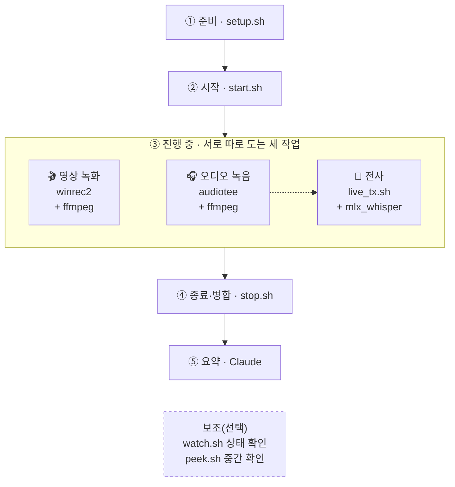
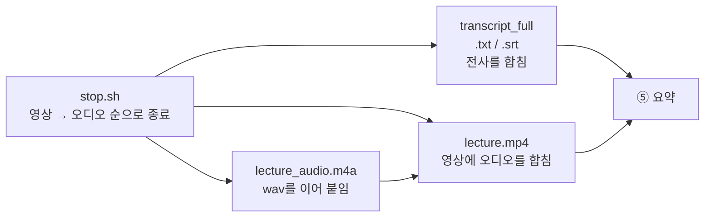
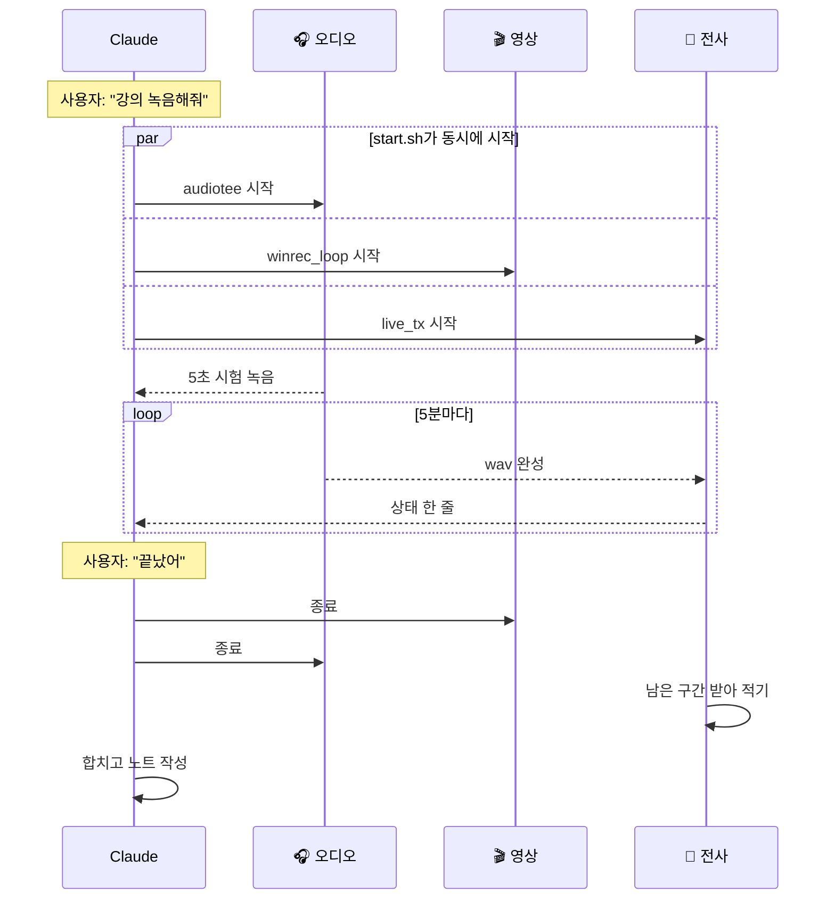

# lecture-capture

macOS에서 듣고 있는 Zoom 강의를 녹음·녹화하고, 한국어로 받아 적은 뒤 강의 노트로 정리해 주는 플러그인입니다.

- **오디오:** 시스템 소리를 Core Audio tap([AudioTee](https://github.com/makeusabrew/audiotee))으로 가져옵니다.
- **영상:** ScreenCaptureKit으로 Zoom 회의 창 하나만 캡처합니다. 다른 창이 위에 겹쳐도 화면에 찍히지 않습니다. 프레임은 ffmpeg로 넘겨 5분 단위 mkv(10fps)로 저장합니다.
- **전사:** mlx-whisper(`whisper-large-v3-turbo`)로 5분 구간이 끝날 때마다 내 Mac에서 받아 적습니다. (로컬 모델 사용)
- **상태 확인:** `watch.sh`를 Claude Code의 Monitor에 연결하면, 구간이 끝날 때마다 상태를 알려 줍니다.

## 1. 한눈에 보기

### 1.1 전체 흐름

- 전체 흐름은 **준비 → 시작 → 진행 중 → 종료·병합 → 요약** 다섯 단계입니다. 
- `start.sh`가 오디오 녹음, 영상 녹화, 전사를 한꺼번에 시작합니다.
- 진행 중에는 이 세 작업이 서로 따로(각자 프로세스로) 돌아갑니다.



`audiotee`와 `winrec2`는 named pipe(`.audio.fifo`, `.video.fifo`)로 `ffmpeg`에 데이터를 넘기고, `ffmpeg`가 5분마다 파일을 나눕니다.

### 1.2 구성 요소: 작업마다 쓰는 프로그램

녹음, 녹화, 전사는 서로 다른 프로그램이 각자 프로세스로 돌아갑니다. 하나가 죽어도 나머지는 계속 돌고, `watch.sh`가 프로세스별로 따로 감시합니다.

| 작업 | 역할 | 프로그램 | macOS 기능 / 모델 | 입력 → 출력 | 필요한 권한 |
|---|---|---|---|---|---|
| 🎧 **오디오 녹음** | 시스템 소리를 복사해 5분 단위 wav로 저장 | `audiotee` → `ffmpeg` | Core Audio tap (macOS 14.2+) | 시스템 소리 → `audio/part_NNN.wav` | 화면 및 시스템 오디오 녹음 |
| 🎬 **영상 녹화** | Zoom 회의 창만 캡처해 5분 단위 mkv로 저장 | `winrec2` → `ffmpeg`(libx264). `winrec_loop.sh`가 창을 잃으면 다시 시작 | ScreenCaptureKit | Zoom 회의 창 → `video/v_HHMMSS.mkv` | 화면 및 시스템 오디오 녹음 |
| 📝 **전사** | 완성된 wav를 한국어로 받아 적기 | `live_tx.sh` → `mlx_whisper` | `whisper-large-v3-turbo` (내 Mac에서 실행, MLX) | `part_NNN.wav` → `transcript/part_NNN.txt·.srt` | 없음 |
| 👀 **상태 확인** (보조) | 구간이 끝날 때마다 상태를 알리고, 프로세스가 죽으면 경고 | `watch.sh` (Claude Code Monitor) | — | `.pids`, 파일 → 한 줄 | 없음 |
| 🔍 **중간 확인** (보조) | 녹음 중인 구간을 바로 받아 적어서 보여 줌 | `peek.sh` (직접 실행) | `whisper-large-v3-turbo` | 녹음 중인 wav → 화면 출력 | 없음 |

프로그램별 출처와 설치 방법입니다.

| 프로그램 | 출처 | 설치 |
|---|---|---|
| `audiotee` | 외부 오픈소스 ([makeusabrew/audiotee](https://github.com/makeusabrew/audiotee), MIT) | `setup.sh`가 릴리스에서 내려받음 |
| `winrec2` | 이 플러그인에 들어 있는 Swift 코드 (`scripts/winrec2/main.swift`) | `setup.sh`가 릴리스에서 내려받음 |
| `ffmpeg` | 외부 | `brew install ffmpeg` |
| `mlx_whisper` | 외부 (`mlx-whisper`) | `setup.sh`가 `uv tool install`로 설치 |

**세 작업이 이어지는 곳은 여기뿐입니다.**
- 전사는 오디오가 wav 파일을 완성하면 그 파일을 읽어 갑니다. 파일로만 이어져 있어서, 오디오가 다음 구간을 녹음하는 동안에도 전사는 뒤따라가며 돌아갑니다.
- 영상 루프는 오디오 tap이 살아 있는 동안만 돕니다. 즉 오디오가 녹음 전체의 기준 시계입니다.
- 영상과 오디오는 진행 중에는 서로 모르고, 종료한 뒤 `merge.py`가 파일 이름의 시작 시각으로 맞춥니다.

### 1.3 종료·병합: 무엇이 만들어지나



## 2. 시간 순서

Claude와 세 작업이 시간 순으로 어떻게 주고받는지 보여 줍니다. 사용자의 요청은 노란 메모로 표시했습니다.



## 3. 산출물

최상단에는 **최종 결과만** 두고, 중간 결과는 모두 `intermediate/` 아래에 둡니다.

```
lecture_YYYYMMDD_HHMM/
├── lecture_audio.m4a            오디오
├── transcript_full.txt          전사 전문
├── transcript_full.srt          자막 파일 (영상에 들어 있지 않은 별도 파일)
├── lecture.mp4                  영상 + 오디오 (최종 결과)
│                                
└── intermediate/                중간 결과
    ├── audio/part_000.wav …         5분 단위 오디오
    ├── video/v_HHMMSS.mkv …         5분 단위 영상
    ├── transcript/part_000.txt …    구간별 전사
    └── logs/                        프로세스별 로그
```

- `lecture.mp4`에는 자막이 들어 있지 않습니다.
- 자막이 필요하면 플레이어에서 `transcript_full.srt`를 같이 불러오세요.

## 4. 사용

Claude Code에서 "줌 강의 녹음해서 정리해줘"라고 말하면 스킬이 위 순서대로 진행합니다. 직접 실행하려면 다음과 같이 합니다.

```bash
scripts/doctor.sh                     # 실행 전 점검: 설치, 권한, 전사, Zoom 창, 저장 공간 (--quick: 소리 시험 생략)
scripts/setup.sh                      # 처음 한 번: 설치
scripts/start.sh ~/Desktop/lecture_x  # 녹음·녹화·전사 시작 (종료 코드 3 = 무음)
scripts/peek.sh  ~/Desktop/lecture_x  # 녹음 중인 구간을 바로 받아 적기
scripts/watch.sh ~/Desktop/lecture_x  # 상태 확인 (구간마다 한 줄)
scripts/stop.sh  ~/Desktop/lecture_x  # 종료하고 오디오·전사·영상 합치기
```

## 5. 요구 사항

- Apple Silicon, macOS 14.2 이상
- ffmpeg, uv (`brew install ffmpeg uv`)
- `scripts/setup.sh`가 `audiotee`와 `winrec2`를 이 플러그인 버전의 GitHub Release에서 내려받아 SHA256을 확인한 뒤 설치합니다. 소스에서 직접 빌드하려면 `LECTURE_BUILD_FROM_SOURCE=1 scripts/setup.sh`를 쓰세요(개발용).
- 권한: 시스템 설정 → 개인정보 보호 및 보안 → 화면 및 시스템 오디오 녹음에서 사용하는 터미널 앱을 켜야 합니다. 권한이 없으면 오류 없이 무음으로 녹음됩니다.
- 설치와 권한이 제대로 됐는지는 `scripts/doctor.sh`로 한 번에 확인할 수 있습니다.

서드파티 라이선스(AudioTee, MIT)는 [NOTICE.md](NOTICE.md)를 참고하세요.

강의를 녹음·녹화하기 전에 주최 측 허락을 받았는지 확인하세요.
